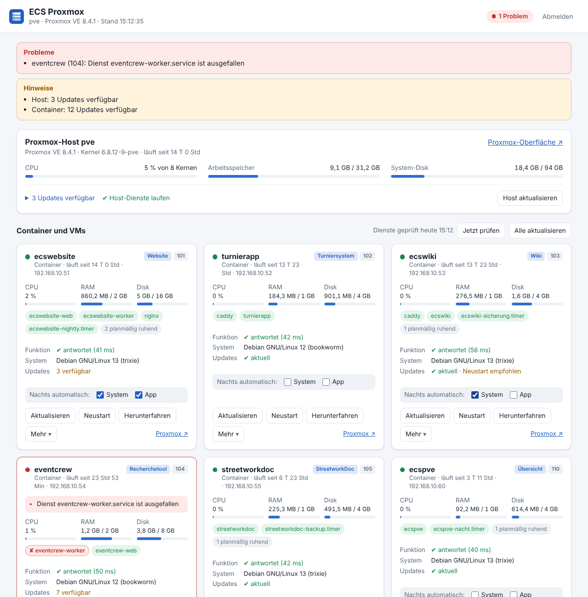
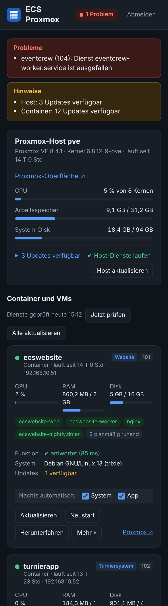

# ECS Proxmox – Übersicht der Container und Dienste

Eine einzige Webseite für den Proxmox-Host der Event Crew Steinfurt: Läuft alles? Sind Updates fällig? Mit einem
Klick neu starten, aktualisieren oder einen hängenden Dienst wieder anwerfen – ohne Kommandozeile. Dazu
Schnittstellen für Monitoring-Werkzeuge und nächtliche automatische Updates.



- **Ein eigener, kleiner Container** (Debian, 1 CPU, 512 MB) – spricht nur **HTTP**, HTTPS macht euer Caddy davor.
- **Keine Abhängigkeiten**: Python aus Debian, keine Pakete aus dem Internet, kein Build-Schritt.
- **Kennt eure Apps**: Website, Wiki, Turniersystem, Recherchetool, StreetworkDoc – mit deren eigener
  Funktionsprüfung (`/healthz`) und deren eigenem Update-Weg (`pve-install.sh --pull` usw.).

## Was die Seite kann

| Bereich | Was | Wie |
|---|---|---|
| Überblick | Proxmox-Host: CPU, Arbeitsspeicher, System-Disk, verfügbare Updates (mit Paketliste), „neuer Kernel – Neustart nötig“, ausgefallene Host-Dienste | alle 10 Sekunden |
| | jeder Container und jede VM: läuft/aus, Laufzeit, IP, CPU, RAM, Disk | alle 10 Sekunden |
| | in jedem Container: die eigenen systemd-Dienste und Zeitpläne (grün = läuft, rot = ausgefallen, grau = ruht planmäßig), Funktionsprüfung der App mit Antwortzeit, Betriebssystem, verfügbare Updates, „Neustart empfohlen“, Snapshots vor Updates | jede Minute |
| Bedienen | Starten, Neustart, Herunterfahren, hart ausschalten | Knöpfe in der Karte |
| | Dienst neu starten | Klick auf den Dienst (z. B. den roten `eventcrew-worker`) |
| | Aktualisieren: System und App, nur Betriebssystem, nur App – vorher ein Snapshot | „Aktualisieren“ bzw. „Mehr“ |
| | alle Container nacheinander aktualisieren, Proxmox-Host aktualisieren | Knöpfe über den Karten bzw. in der Host-Karte |
| | jedes Update, jeder Neustart mit vollständigem Protokoll | Liste „Aufträge“ |
| Automatisch | Nachtlauf um 04:30 (nach den Sicherungen der Apps): je Container per Häkchen **System** und/oder **App**; Paketlisten überall auffrischen; Bericht auf der Seite und per Benachrichtigung | Karte „Automatische Updates“ |
| Monitoring | `/health` (200/503), `/api/status` (JSON), `/metrics` (Prometheus), Push an ntfy, Heartbeat an Uptime Kuma/healthchecks.io | [Monitoring anbinden](#monitoring-anbinden) |

Die Seite ist bewusst einfach: keine Benutzerverwaltung, ein Passwort, deutsch, hell und dunkel, auch am Handy
bedienbar.



## Wie es aufgebaut ist

```
 Browser ──HTTPS──► Caddy (euer Reverse Proxy) ──HTTP──► Container „ecspve“ :8080
                                                          │  Weboberfläche, Anmeldung, Monitoring,
                                                          │  Nachtlauf (systemd-Timer)
                                                          │
                                                          │  SSH – Schlüssel darf NUR ecspve-helfer starten
                                                          ▼
                                      Proxmox-Host: /usr/local/sbin/ecspve-helfer
                                        pvesh · pct · qm · apt-get · pve-install.sh der Apps
                                                          │
                                                          ▼
                                      Container: ecswebsite · ecswiki · turnierapp · eventcrew · …
```

Ein Container kommt von sich aus nicht an `pct` und die anderen Container heran – und soll es auch nicht. Deshalb
liegt auf dem Host ein kleiner **Helfer** mit einer festen Liste erlaubter Befehle (`uebersicht`, `pruefen`,
`start`, `update`, `dienst` …). Der SSH-Schlüssel des Containers ist in `/root/.ssh/authorized_keys` mit
`restrict,command="/usr/local/sbin/ecspve-helfer"` genau darauf festgelegt: keine Shell, keine Weiterleitungen,
Container-IDs und Dienstnamen werden geprüft. Hat der Container eine feste IP, gilt der Schlüssel nur von dort.

Updates und Neustarts laufen auf dem Host als eigene systemd-Einheit (`ecspve-<Auftrag>`) – sie laufen weiter, auch
wenn die Verbindung abreißt oder die Übersicht selbst neu startet. Mehrere Updates laufen nie gleichzeitig.

### Die Apps, die die Übersicht kennt

Erkannt wird eine App an ihrer systemd-Einheit im Container – egal, welche ID oder welchen Namen der Container hat.

| App | erkannt an | Funktionsprüfung im Container | App-Update (auf dem Host) |
|---|---|---|---|
| Website | `ecswebsite-web.service` | `http://127.0.0.1:8000/healthz` | `/opt/ecswebsite/pve-install.sh --pull --update --ctid=<ID>` |
| Wiki | `ecswiki.service` | `http://127.0.0.1:3100/healthz` | `/opt/ecswiki/pve-install.sh --pull --update --ctid=<ID>` |
| Turniersystem | `turnierapp.service` | `http://127.0.0.1:3000/healthz` | `turnierapp-update-lxc <ID> --pull` (sonst `turnierapp-update` im Container) |
| Recherchetool | `eventcrew-web.service` | `deploy/lxc/probe.py` der App | `pct exec <ID> -- bash /opt/eventcrew-app/deploy/lxc/update.sh` |
| StreetworkDoc | `streetworkdoc.service` | `https://127.0.0.1:8443/api/v1/info` | `git pull` + `deploy/proxmox/create-lxc.sh --update <ID>` im Projektordner (`STREETWORKDOC_QUELLE`) |
| Übersicht (diese App) | `ecspve.service` | `ecspve ping` | `/opt/ecspve/pve-install.sh --pull --update --ctid=<ID>` |

Andere Container (z. B. euer Caddy) zeigt die Übersicht genauso – mit Diensten, Updates und Betriebssystem-Update,
nur ohne App-Prüfung und App-Update. Eigene Prüfungen und Update-Befehle je Container gehen in
`/etc/ecspve/helfer.conf` auf dem Host (siehe [Einstellungen](#einstellungen)).

## Installation

Alles auf dem **Proxmox-Host** als root.

**1. Projektordner holen.** Das Repository ist privat – wie bei Wiki und Website mit einem eigenen Deploy-Key:

```bash
ssh-keygen -t ed25519 -N '' -C "ecspve@$(hostname)" -f /root/.ssh/ecspve_deploy
cat /root/.ssh/ecspve_deploy.pub     # auf GitHub: ecspve → Settings → Deploy keys → Add (nur lesen)
cat >>/root/.ssh/config <<'EOF'
Host github-ecspve
  HostName github.com
  User git
  IdentityFile /root/.ssh/ecspve_deploy
  IdentitiesOnly yes
EOF
git clone github-ecspve:mmeintgens-arch/ecspve.git /opt/ecspve
```

**2. Container anlegen.** Am besten mit fester IP – dann gilt der SSH-Schlüssel nur von dieser Adresse. `--proxy-ip`
ist die IP eures Caddy (damit die Anmeldesperre die echte Besucher-IP sieht):

```bash
/opt/ecspve/pve-install.sh --ip=192.168.10.60/24 --gw=192.168.10.1 --proxy-ip=192.168.10.2
```

Das Skript fragt nach einem Passwort (leer = zufällig, gespeichert in `/root/ecspve-ct<ID>-passwort.txt`), legt einen
unprivilegierten Debian-Container mit dem Tag `ecspve` an, installiert dort die Übersicht, richtet auf dem Host den
Helfer ein, gibt den Schlüssel frei und prüft die Verbindung. Weitere Optionen: `--help`.

**3. Caddy davor.** Die Übersicht darf alles neu starten – sie gehört nicht offen ins Internet. Im Caddyfile eures
Proxys, z. B. nur aus dem Vereinsnetz:

```caddy
status.eventcrew-steinfurt.de {
	@extern not remote_ip private_ranges
	respond @extern "Nur im Vereinsnetz erreichbar" 403
	reverse_proxy 192.168.10.60:8080
}
```

Oder ohne Domain nur intern (`tls internal`). Dann `https://status…` öffnen und mit dem Passwort anmelden.

**4. Automatische Updates auswählen.** In jeder Karte bei „Nachts automatisch“ die Häkchen setzen: **System**
(Debian-Pakete im Container) und/oder **App** (der Update-Weg der App aus der Tabelle oben).

## Automatische Updates

Der Nachtlauf (`ecspve-nacht.timer`, 04:30 plus bis zu 15 Minuten – nach den Sicherungen von Website 03:20 und Wiki
03:40) macht:

1. Paketlisten in allen laufenden Containern auffrischen – damit „Updates verfügbar“ stimmt, auch ohne Häkchen.
2. Proxmox-Host aktualisieren – nur mit `HOST_AUTO_UPDATE=ja` (Standard: nein).
3. Jeden ausgewählten Container nacheinander:
   - **Snapshot** `ecspve_<Datum>` (die letzten 2 bleiben, `SNAPSHOTS_BEHALTEN`). Kann der Speicher keine Snapshots,
     läuft das Update trotzdem und der Auftrag zeigt eine Warnung.
   - **System**: `apt-get update && apt-get full-upgrade` (angepasste Konfigurationsdateien bleiben), `autoremove`.
   - **App**: der eingebaute Update-Weg der App – inklusive deren eigener Sicherung vor dem Update.
   - Danach prüfen: laufen alle Dienste, antwortet die App? Wenn nicht, steht der Auftrag auf „Warnung“, die Karte
     wird rot, und es gibt eine Benachrichtigung.
   - Verlangt ein Update einen Neustart (`/run/reboot-required`), zeigt die Karte „Neustart empfohlen“; mit
     `NEUSTART_NACH_UPDATE=ja` startet der Container gleich neu.
4. Die Übersicht selbst kommt zuletzt dran.

Zurück zu einem Snapshot: in Proxmox beim Container unter **Snapshots** → **Rollback**.

Andere Uhrzeit: im Container `systemctl edit ecspve-nacht.timer` und dort

```ini
[Timer]
OnCalendar=
OnCalendar=*-*-* 05:15:00
```

Den Proxmox-Host selbst startet die Übersicht nie neu – nach einem neuen Kernel zeigt sie „Neustart nötig“, den
Neustart löst ihr zu einer ruhigen Zeit in der Proxmox-Oberfläche aus.

## Monitoring anbinden

Unten auf der Seite stehen die fertigen Adressen zum Kopieren (inklusive Token).

| Schnittstelle | Antwort | Anmeldung |
|---|---|---|
| `GET /health` | `200 OK` oder `503 FEHLER: 2 Probleme` | keine (mit Token zusätzlich die Texte) |
| `GET /api/status` | alles, was die Seite zeigt, als JSON (`ok`, `probleme`, `host`, `gaeste` …) | Token |
| `GET /metrics` | Prometheus-Format, z. B. `ecspve_ok`, `ecspve_gast_laeuft`, `ecspve_dienst_ok`, `ecspve_pruefung_ok`, `ecspve_gast_updates`, `ecspve_host_neustart_noetig` | Token |
| `GET /ping` | `ok` – nur „läuft die Übersicht selbst?“ | keine |

Das Token geht als `Authorization: Bearer <Token>` oder als `?token=<Token>`. Neu erzeugen im Container:
`ecspve token --neu`.

**Uptime Kuma**

- einfach: Monitor „HTTP(s)“ auf `https://status…/health` – rot, sobald irgendetwas gestört ist.
- genauer: Monitor „HTTP(s) – Json Query“ auf `https://status…/api/status?token=…`, Ausdruck `ok`, erwarteter Wert
  `true`.
- umgekehrt (Push, falls Kuma die Übersicht nicht erreicht): Monitor „Push“ anlegen und dessen Adresse als
  `HEARTBEAT_URL=https://kuma…/api/push/AbCd?status={status}&msg={msg}` eintragen.

**Prometheus / Grafana**

```yaml
scrape_configs:
  - job_name: ecspve
    scheme: https
    authorization:
      credentials: "<Token>"
    static_configs:
      - targets: ["status.eventcrew-steinfurt.de"]
```

Beispiel-Alarm: `ecspve_dienst_ok == 0` oder `ecspve_pruefung_ok == 0` länger als 5 Minuten.

**Checkmk, Zabbix, Nagios** – HTTP-Check auf `/health` (Statuscode 200), oder Prometheus-Anbindung auf `/metrics`.

**Benachrichtigung aufs Handy (ntfy)** – `MELDUNG_URL=https://ntfy.sh/<geheimes-thema>` (oder euer eigener
ntfy-Server, ggf. mit `MELDUNG_TOKEN`). Dann kommen: Störungen (wenn sie mindestens 30 Sekunden bestehen), „wieder in
Ordnung“ und das Ergebnis jedes Nachtlaufs.

## Einstellungen

**Im Container: `/etc/ecspve/ecspve.env`** (die meisten Werte gelten nach wenigen Sekunden, `ADRESSE`/`PORT` nach
`systemctl restart ecspve`)

| Einstellung | Standard | Bedeutung |
|---|---|---|
| `PVE_HOST` | IP des Hosts | Proxmox-Host mit dem Helfer (trägt `pve-install.sh` ein) |
| `PVE_URL` | `https://PVE_HOST:8006` | Adresse der Proxmox-Oberfläche für die Links |
| `ADRESSE`, `PORT` | `0.0.0.0`, `8080` | Webserver (nur HTTP) |
| `PROXY_IP` | – | IP(s) eures Reverse Proxys, für die echte Besucher-IP |
| `TOKEN` | zufällig | für `/api/status` und `/metrics` |
| `SNAPSHOTS_BEHALTEN` | `2` | Snapshot vor jedem Update, so viele bleiben (0 = keiner) |
| `NEUSTART_NACH_UPDATE` | `nein` | Container neu starten, wenn ein Update es verlangt |
| `HOST_AUTO_UPDATE` | `nein` | Proxmox-Host im Nachtlauf mit aktualisieren |
| `MELDUNG_URL`, `MELDUNG_TOKEN` | – | ntfy-Thema für Benachrichtigungen |
| `HEARTBEAT_URL` | – | Push-Adresse (Uptime Kuma, healthchecks.io), jede Minute |
| `HEALTH_DETAILS` | `nein` | `/health` nennt ohne Token auch die Texte der Probleme |

**Auf dem Host: `/etc/ecspve/helfer.conf`**

| Einstellung | Standard | Bedeutung |
|---|---|---|
| `STREETWORKDOC_QUELLE` | `/root/StreetworkDoc` | Projektordner von StreetworkDoc für dessen App-Update |
| `HOST_UPDATE` | `ja` | Host-Updates über die Übersicht erlauben (`nein` = nur anzeigen) |
| `PRUEFUNG_<ID>` | – | eigene Funktionsprüfung im Container: Adresse (`http://127.0.0.1:8123/`) oder Befehl |
| `UPDATE_<ID>` | – | eigener App-Update-Befehl auf dem Host, `{id}` = Container-ID |

Die Auswahl „nachts automatisch“ und der Bericht des letzten Nachtlaufs liegen im Container in `/var/lib/ecspve`.

## Bedienung im Terminal

Im Container der Übersicht:

```bash
ecspve status          # dasselbe wie die Seite, als Liste
ecspve verbindung      # erreicht der Container den Helfer auf dem Host?
ecspve passwort        # Passwort der Weboberfläche neu setzen
ecspve token --neu     # neues Token für Monitoring
journalctl -u ecspve -f
```

Auf dem Host:

```bash
ecspve-helfer uebersicht | python3 -m json.tool | less
ecspve-helfer pruefen    | python3 -m json.tool | less
ls -t /var/lib/ecspve-helfer/auftraege/*.log | head   # Protokolle der Aufträge
```

## Update der Übersicht

```bash
/opt/ecspve/pve-install.sh --pull
```

Holt den neuesten Stand, spielt ihn in den Container ein und erneuert den Helfer auf dem Host. Einstellungen,
Passwort, Token und Auswahl bleiben. Mit dem Häkchen **App** in der Karte der Übersicht passiert das auch nachts.

## Sicherheit

- Die Weboberfläche kann Container neu starten und Updates anstoßen – nur hinter eurem Caddy mit HTTPS betreiben,
  am besten nur aus dem Vereinsnetz bzw. per VPN erreichbar.
- Anmeldung mit Passwort (PBKDF2), Sitzung 12 Stunden, nach 5 Fehlversuchen 15 Minuten Sperre je IP.
  Aktionen brauchen einen eigenen Header (Schutz vor fremden Formularen), Cookies sind `HttpOnly` und
  `SameSite=Strict`, hinter HTTPS auch `Secure`.
- Was der Container auf dem Host darf, steht vollständig in `deploy/proxmox/ecspve-helfer` – nichts darüber hinaus.
  Freigabe zurücknehmen: die Zeile mit `ecspve-ct<ID>` aus `/root/.ssh/authorized_keys` löschen.
- Das Monitoring-Token erlaubt nur Lesen.

## Entwicklung und Tests

Ohne Proxmox, gegen einen nachgebauten Host (`test/fake.py` ersetzt `pct`, `pvesh`, `systemctl` … und führt das
echte Prüfskript aus):

```bash
python3 -m unittest discover -s test -v       # Tests (Python 3.11 wie auf Proxmox VE 8, und neuer)
python3 test/fake.py /tmp/ecspve-demo --demo  # Vorschau auf http://127.0.0.1:8080, Passwort: demo-passwort
```

| Datei | Wo sie läuft | Was |
|---|---|---|
| `ecspve.py` | Container | Weboberfläche, Monitoring, Benachrichtigungen, Nachtlauf, Kommandozeile |
| `web/` | Browser | die Seite (HTML, CSS, JavaScript ohne Bibliotheken) |
| `deploy/proxmox/ecspve-helfer` | Proxmox-Host | die erlaubten Befehle, Prüfskript, Aufträge |
| `pve-install.sh` | Proxmox-Host | Container anlegen/aktualisieren, Helfer und Schlüssel einrichten |
| `deploy/install.sh` | Container | Installation im Container (ruft `pve-install.sh` auf) |
